# ¿Qué hay en la foto?

Tomas una foto con el teléfono, la subes, y en un par de segundos la aplicación te dice qué ve en ella, con un porcentaje al lado de cada cosa. La foto queda guardada en un bucket de Cloud Storage y aparece en una galería con las últimas fotos del grupo. Quien reconoce lo que hay en la imagen no es código tuyo: es Cloud Vision, un modelo que Google ya entrenó y que se usa con una petición HTTP.

La plantilla trae las dos aplicaciones completas y la infraestructura del frontend y el backend. Tu grupo construye en Terraform el bucket, el permiso del backend sobre él y el acceso a Vision.

| Sin bucket todavía | Con etiquetas | La galería |
|---|---|---|
| 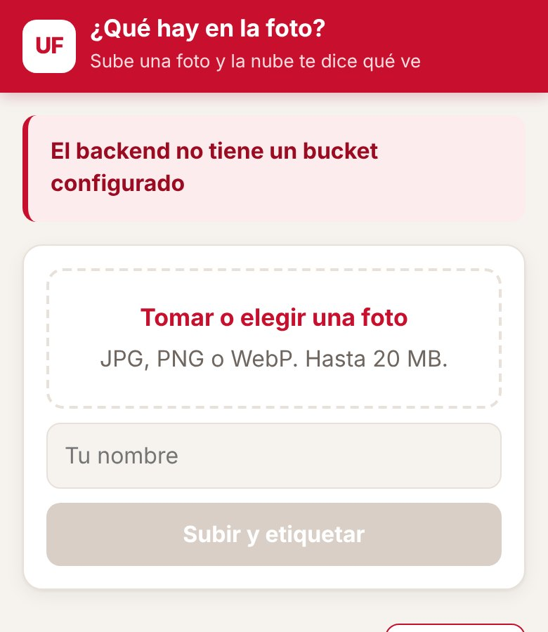 | 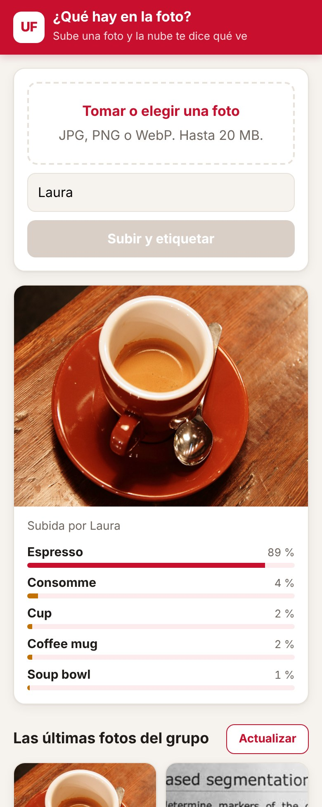 | 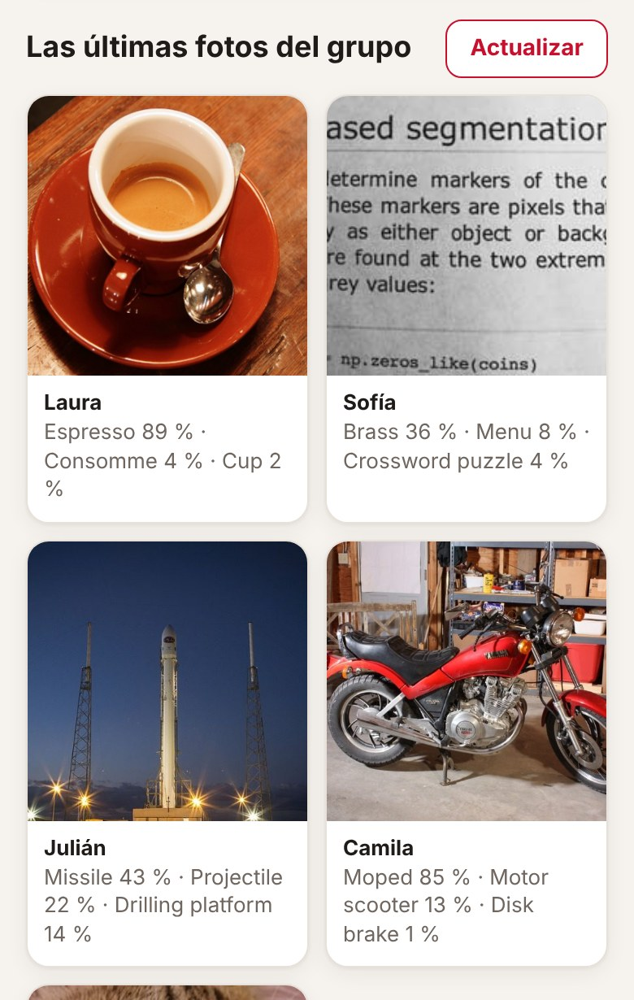 |

Las capturas salen de una prueba local: Cloud Storage simulado y, en lugar de Vision, un modelo de clasificación pequeño corriendo en el computador. Por eso las etiquetas de las capturas no son las de Vision; las reales las vas a ver cuando lo despliegues.

## Arquitectura al terminar la práctica

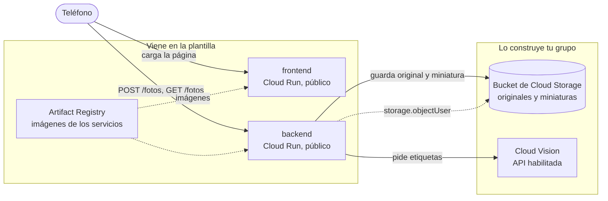

La flecha punteada es el único permiso de IAM que da tu grupo: la cuenta del backend puede crear, leer y listar objetos en ese bucket y en ningún otro. Para llamar a Vision no hace falta ningún rol: basta con que la API esté habilitada en el proyecto y con que el backend corra con una cuenta de servicio del mismo proyecto.

En la plantilla, la variable `BUCKET` del backend está vacía: responde que no tiene dónde guardar y no guarda nada. Es lo primero que vas a ver al desplegar.

## Estructura del repositorio

```
backend/main.py            API en Flask: recibe la foto, hace la miniatura, pide etiquetas y guarda en el bucket
backend/requirements.txt   Dependencias del backend con versión fija
backend/Dockerfile         Imagen del backend con gunicorn
frontend/index.html        La página: subir una foto, ver sus etiquetas y la galería del grupo
frontend/server.py         Servidor sin dependencias que inyecta BACKEND_URL en la página
frontend/Dockerfile        Imagen del frontend
infra/providers.tf         Versión de Terraform y del proveedor de Google
infra/variables.tf         Proyecto, prefijo, región e imágenes
infra/main.tf              APIs, registro, backend y frontend con sus cuentas
infra/outputs.tf           Ruta del registro y URL de los servicios
infra/terraform.tfvars.example   Ejemplo de valores; cópialo como terraform.tfvars
docs/api.md                Endpoints del backend y cómo se guardan las fotos
docs/capturas/             Capturas de la aplicación usadas en este README
.gitignore                 Deja por fuera el estado de Terraform, tus tfvars y __pycache__
```

## Cómo empezar

### Flujo de trabajo

1. Crea el repositorio de tu grupo con **Use this template** en GitHub.
2. Edita en VS Code o en github.dev (tecla `.` en la página del repositorio).
3. Haz commit y push desde el editor.
4. En Cloud Shell clonas la primera vez y traes los cambios con `git pull` después. Desde Cloud Shell nunca haces push.
5. Docker y Terraform se ejecutan siempre en Cloud Shell. La consola de Google Cloud es para mirar y diagnosticar, no para crear recursos.

### Primer despliegue

En Cloud Shell:

```bash
git clone https://github.com/<tu-usuario>/<tu-repositorio>.git
cd <tu-repositorio>/infra
cp terraform.tfvars.example terraform.tfvars
cloudshell edit terraform.tfvars
```

En `terraform.tfvars` pon el ID de tu proyecto y el prefijo del grupo, y ajusta las rutas de las imágenes a esos mismos valores. Este archivo vive solo en Cloud Shell: el `.gitignore` evita que llegue a GitHub.

El orden importa, porque las imágenes necesitan el registro y los servicios necesitan las imágenes:

```bash
# 1. Solo el registro (y las APIs de las que depende)
terraform init
terraform apply -target=google_artifact_registry_repository.registro

# 2. Las imágenes
REGISTRO=$(terraform output -raw registro)
gcloud auth configure-docker us-central1-docker.pkg.dev --quiet
cd ..
docker build -t $REGISTRO/backend:v1 backend
docker push $REGISTRO/backend:v1
docker build -t $REGISTRO/frontend:v1 frontend
docker push $REGISTRO/frontend:v1

# 3. Todo lo demás
cd infra
terraform apply
terraform output
```

Abre `url_frontend` en el teléfono. Si usas otra región, cambia `us-central1` en el comando de `gcloud auth configure-docker`, y ten en cuenta que la cuota gratuita de Cloud Storage solo aplica en `us-central1`, `us-east1` y `us-west1`.

Cuando cambies el código de un servicio, construye y sube la imagen con una etiqueta nueva (`v2`, `v3`...), actualízala en `terraform.tfvars` y vuelve a aplicar. Si subes otra vez la misma etiqueta, Terraform no ve ningún cambio y Cloud Run sigue con la versión anterior.

## Probar cada servicio con `docker run`

Antes de subir una imagen, pruébala en Cloud Shell. Para ver una página servida en Cloud Shell usa **Vista previa en la Web** y elige el puerto.

**Frontend.** No necesita credenciales:

```bash
docker run --rm -p 8080:8080 -e BACKEND_URL=https://<url-del-backend> $REGISTRO/frontend:v1
```

Abre la vista previa en el puerto 8080. Si no pasas `BACKEND_URL`, la página va a decir que no pudo hablar con el backend.

**Backend sin bucket.** El contenedor arranca aunque no tenga credenciales, y sin la variable `BUCKET` responde con un error claro:

```bash
docker run --rm -d --name backend -p 8081:8080 $REGISTRO/backend:v1
curl -i localhost:8081/fotos
docker logs backend
docker rm -f backend
```

Debe responder `503` con el error en JSON y una advertencia en los registros.

**Backend con bucket.** Cuando el bucket ya existe y la API de Vision está habilitada, puedes darle al contenedor tus propias credenciales:

```bash
gcloud auth application-default login
docker run --rm -d --name backend -p 8081:8080 \
  -e GOOGLE_CLOUD_PROJECT=<tu-proyecto> \
  -e BUCKET=<nombre-del-bucket> \
  -e GOOGLE_APPLICATION_CREDENTIALS=/adc.json \
  -v $HOME/.config/gcloud/application_default_credentials.json:/adc.json:ro \
  $REGISTRO/backend:v1
curl -X POST localhost:8081/fotos -F "autor=Ana" -F "foto=@una-foto.jpg"
curl localhost:8081/fotos
```

Los detalles de cada endpoint están en [docs/api.md](docs/api.md).

---

# Informe del grupo

Grupo 2. Prefijo de los recursos: `jorge-adolfo`. Proyecto de quien despliega: `project-56eb9056-3ab4-4adb-b64`, región `us-central1`.

## Integrantes

| Nombre | Código | Usuario de GitHub |
|---|---|---|
| Jorge Reyes | | [JorgeAgar](https://github.com/JorgeAgar) |
| Adolfo Alejandro Arenas | | |

## URL de la aplicación

Frontend: https://jorge-adolfo-frontend-sq3337hevq-uc.a.run.app

Backend: https://jorge-adolfo-backend-sq3337hevq-uc.a.run.app

Después de las pruebas se hizo `terraform destroy` para no dejar nada cobrando. Para la revisión se vuelve a levantar con los pasos de [Reproducir desde cero](#cómo-reproducimos) y las URL quedan iguales: Cloud Run las arma con el nombre del servicio, el proyecto y la región, como se comprobó al reproducir.

## Diagrama propio

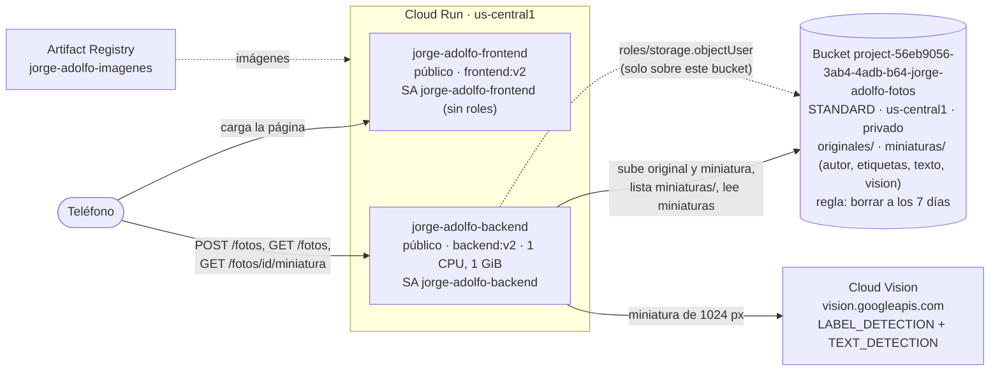

La flecha punteada con el rol es el único permiso de IAM que dio el grupo, y va sobre el bucket, no sobre el proyecto. Vision no necesita rol: basta con que la API esté habilitada en el proyecto y que la llame una cuenta de servicio del mismo proyecto. El bucket tiene `public_access_prevention = "enforced"` y acceso uniforme, así que ninguna foto se puede hacer pública ni por error.

Todo está en [infra/main.tf](infra/main.tf) (plantilla, más `BUCKET` y la línea de Vision) y en [infra/storage.tf](infra/storage.tf) (lo que escribió el grupo).

## Evidencias por fase

Las capturas están en [docs/capturas](docs/capturas) y las salidas completas de los comandos en [docs/evidencias](docs/evidencias). Las capturas son de la página real en un navegador con tamaño de teléfono, y las fotos se subieron desde el formulario de la página. Las horas son UTC.

### Fase 0. Preparación

Repositorio: https://github.com/JorgeAgar/practica6-foto. Despliega Jorge, con su proyecto:

```
$ gcloud config list
[core]
project = project-56eb9056-3ab4-4adb-b64
```

Los registros de las prácticas 4 y 5 ya estaban destruidos, así que el registro de esta práctica es el único y no se pasa del medio GiB gratis de Artifact Registry.

### Fase 1. Registro, imágenes y el primer despliegue

Salida completa en [fase1.txt](docs/evidencias/fase1.txt).

```
IMAGE     TAGS  CREATE_TIME
backend   v1    2026-11-23 13:05
frontend  v1    2026-11-23 13:05

$ curl -i $B/fotos
HTTP/2 503
{"error":"El backend no tiene un bucket configurado"}

2026-11-23T13:11:33.041613Z  WARNING:backend:BUCKET está vacía: no hay dónde guardar las fotos
```

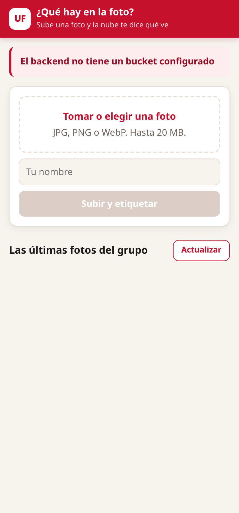

### Fase 2. El bucket

[infra/storage.tf](infra/storage.tf) con el bucket `project-56eb9056-3ab4-4adb-b64-jorge-adolfo-fotos` (`STANDARD`, `us-central1`, acceso uniforme, prevención de acceso público) y `roles/storage.objectUser` para la cuenta del backend sobre ese bucket. Salida completa en [fase2.txt](docs/evidencias/fase2.txt).

```
gs://.../miniaturas/:
     65741  2026-11-23T13:12:48Z  gs://.../miniaturas/20261123-131248-48b452.jpg
gs://.../originales/:
   2855247  2026-11-23T13:12:48Z  gs://.../originales/20261123-131248-48b452.jpeg

- members:
  - serviceAccount:jorge-adolfo-backend@project-56eb9056-3ab4-4adb-b64.iam.gserviceaccount.com
  role: roles/storage.objectUser

2026-11-23T13:12:48.063498Z  WARNING:backend:Vision no respondió: 403 Cloud Vision API has not been used in project 989714552015 before or it is disabled. ...
2026-11-23T13:12:48.372287Z  INFO:backend:Foto 20261123-131248-48b452 guardada por Jorge, 0 etiquetas
```

La foto se guardó y salió en la galería, pero sin etiquetas: la IA falló y la foto no se perdió.

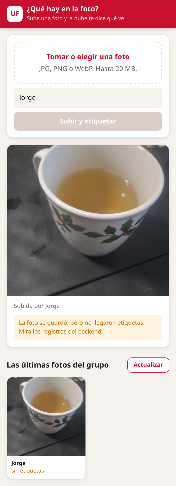

### Fase 3. Vision

Una línea en la lista de APIs: `"vision.googleapis.com",`. Funcionó en la primera foto, sin esperar. Salida completa en [fase3.txt](docs/evidencias/fase3.txt).

```
2026-11-23T13:14:35.821450Z  INFO:backend:Foto 20261123-131435-4ee1d6 guardada por Adolfo, 8 etiquetas

$ gcloud services list --enabled --filter="config.name:vision.googleapis.com"
NAME                   TITLE
vision.googleapis.com  Cloud Vision API
```

La foto de la fase 2 (la taza de Jorge) siguió sin etiquetas: el backend solo le pregunta a Vision al subir.

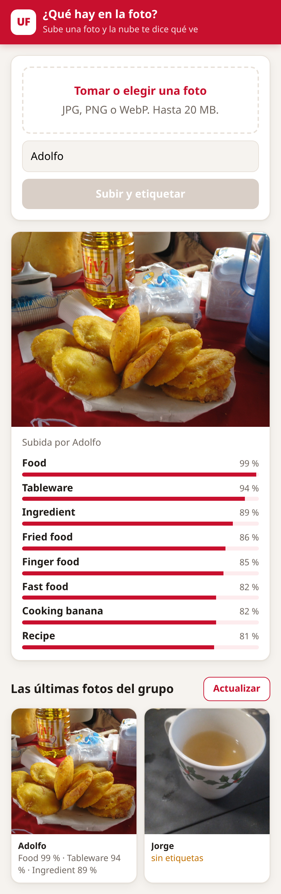

### Fase 4. Ponerlo a prueba

Las fotos salieron de Wikimedia Commons (ver [créditos](#créditos-de-las-fotos)). La taza movida es la misma foto de la taza, con desenfoque de movimiento y menos brillo hechos con ImageMagick. Al ver que el desenfoque suave no le hacía nada, se probó también uno fuerte. Salida completa, con las 8 etiquetas de cada foto, en [fase4.txt](docs/evidencias/fase4.txt).

| # | Foto | Quién | 1.ª etiqueta | 2.ª etiqueta | 3.ª etiqueta | ¿Acertó? |
|---|---|---|---|---|---|---|
| 1 | [Taza de té, bien iluminada](docs/capturas/fase4-1-taza.png) | Jorge | Tableware 0,965 | Serveware 0,940 | Liquid 0,917 | Sí, pero en genérico: «vajilla con líquido». `Cup` sale hasta el 5.º puesto (0,847) y `Tea` el 8.º. Se arriesga con `Tieguanyin` (0,767), un té oolong chino concreto, solo por el color. |
| 2 | [Arepas de huevo](docs/capturas/fase3-etiquetas.png) | Adolfo | Food 0,994 | Tableware 0,939 | Ingredient 0,886 | A medias. Sabe que es comida frita (`Fried food` 0,856, `Finger food` 0,851) pero nunca dice arepa, y en su lugar dice `Cooking banana` (0,822): la confunde con plátano frito, el patacón que sí es común en internet. Lo local no lo conoce. |
| 3 | [El principito: la boa que se tragó un elefante](docs/capturas/fase4-3-dibujo-principito.png) | Adolfo | Brown 0,910 | Natural material 0,687 | — | No. Solo devolvió dos etiquetas, el color y «material natural». No ve el sombrero que veían los adultos del libro, ni la serpiente, ni el elefante. Un dibujo plano, sin texturas, le deja pocos patrones para reconocer. |
| 4 | [Letrero del aeropuerto Camilo Daza, Cúcuta](docs/capturas/fase4-4-letrero-aeropuerto.png) | Jorge | Airport 0,556 | Palm trees 0,538 | Headquarters 0,535 | Acierta `Airport`, pero con confianza baja (todas en ámbar) y probablemente por la arquitectura, porque `label_detection` no lee: no dice nada de Cúcuta ni de Camilo Daza. Con `TEXT_DETECTION` (reto) lee el letrero completo. |
| 5 | [La taza, movida y oscura (suave)](docs/capturas/fase4-5-taza-movida.png) | Adolfo | Tableware 0,945 | Liquid 0,920 | Serveware 0,912 | Sí, igual que la original. `Tea` incluso sube a 0,872 y `Cup` a 0,854: el desenfoque suave no le afecta. |
| 6 | [La taza, muy movida y muy oscura](docs/capturas/fase4-6-taza-muy-movida.png) | Jorge | Tableware 0,956 | Serveware 0,926 | Liquid 0,921 | Sí, y mejor: `Cup` sube al 4.º puesto con 0,909. La forma de la taza sobrevive al desenfoque, y como Vision ve la miniatura de 1024 px, el detalle fino ya se perdía de todos modos. No aparecieron las etiquetas vagas que anticipa la guía, quizá porque el desenfoque es simulado y no un contraluz real. |

Lo que más nos enseñó fue dónde falla: lo local (arepa → plátano) y lo dibujado (la boa no es nada, ni siquiera un sombrero). Las fotos degradadas nos sorprendieron: la taza movida y oscura la reconoce igual o mejor.

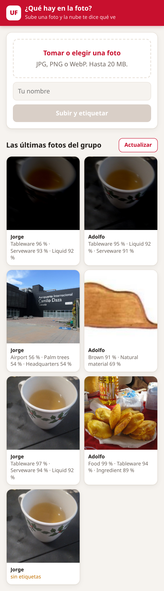

### Fase 5. Mirar el bucket

Salida completa en [fase5.txt](docs/evidencias/fase5.txt). Metadatos de una miniatura:

```
$ gcloud storage objects describe gs://$B/miniaturas/20261123-131548-cc0230.jpg
custom_fields:
  autor: Jorge
  etiquetas: '[{"nombre": "Airport", "confianza": 0.556}, {"nombre": "Palm trees", "confianza": 0.538}, ...]'
  vision: ok
name: miniaturas/20261123-131548-cc0230.jpg
size: 113787
storage_class: STANDARD
```

| Foto | Original | Miniatura | Proporción |
|---|---|---|---|
| Taza (3120 × 4160) | 2.855.247 B | 65.741 B | 43× |
| Arepas (1600 × 1200) | 522.621 B | 115.032 B | 4,5× |
| Letrero (4608 × 3456) | 5.876.801 B | 113.787 B | 52× |
| Dibujo (432 × 124) | 11.486 B | 3.939 B | 2,9× |

Con fotos de cámara, la miniatura pesa entre 30 y 50 veces menos (en promedio 96 KiB contra 2,94 MiB). Con imágenes que ya eran pequeñas, la ganancia es poca: la de 432 px no se agranda, solo se recomprime.

### Fase 6. Reto

- Texto: [fase6-texto.txt](docs/evidencias/fase6-texto.txt)
- Ciclo de vida: [fase6-ciclo-de-vida.txt](docs/evidencias/fase6-ciclo-de-vida.txt)
- Reproducción: [fase6-reproduccion.txt](docs/evidencias/fase6-reproduccion.txt)

**Una foto con su texto en la galería** (backend y frontend `v2`):

```
"texto": "Aeropuerto Internacional\nCamilo Daza\nCúcuta"

$ gcloud storage objects describe gs://$B/miniaturas/20261123-132509-d4e7a8.jpg
custom_fields:
  autor: Jorge
  etiquetas: '[{"nombre": "Airport", ...}]'
  texto: |-
    Aeropuerto Internacional
    Camilo Daza
    Cúcuta
  vision: ok
```

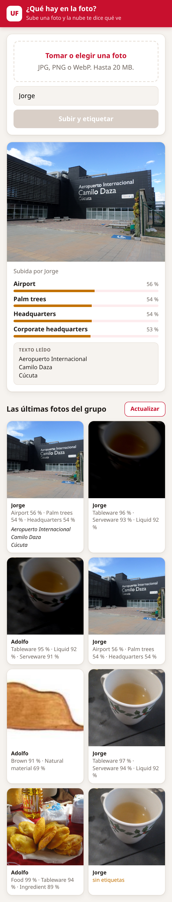

**La regla de ciclo de vida** (vista con `gcloud` y con la API JSON de Cloud Storage, que es lo mismo que muestra la pestaña *Lifecycle* del bucket en la consola):

```
$ gcloud storage buckets describe gs://$B --format='yaml(name,lifecycle_config)'
lifecycle_config:
  rule:
  - action:
      type: Delete
    condition:
      age: 7
name: project-56eb9056-3ab4-4adb-b64-jorge-adolfo-fotos
```

**La cuenta** y **la reproducción** están en [Decisiones del reto](#decisiones-del-reto).

## Decisiones del reto

### Cómo mostramos el texto

El backend ([backend/main.py](backend/main.py)) pide etiquetas y texto en **una sola petición** a Vision, con `annotate_image` y dos funciones: `LABEL_DETECTION` con máximo 8 resultados y `TEXT_DETECTION`. Son dos unidades por foto, pero una sola ida y vuelta. Lee `full_text_annotation.text`, que trae todo el texto en orden de lectura con sus saltos de línea, y lo guarda como el metadato `texto` de la miniatura, en la misma subida que el autor y las etiquetas, así que no cuesta otra operación de clase A. `GET /fotos` lo devuelve como `texto`. El frontend lo muestra en el resultado, en un recuadro «Texto leído», y en la galería, en cursiva bajo las etiquetas, cortado visualmente a tres líneas (el texto completo queda en el `title`).

- **Cuando Vision no encuentra texto** guardamos el metadato `texto` vacío (`""`), no lo omitimos, y la API responde `"texto": null`. En la página no aparece nada, ni un «sin texto» que solo ocuparía espacio. Si Vision falla del todo, `vision` dice `error: ...`, como antes, y `texto` queda vacío. Así, «no hay texto» y «no se pudo leer» se distinguen por `vision`.
- **Cuánto texto cabe.** Cloud Storage admite como máximo 8 KiB de metadatos propios por objeto, sumando nombres y valores. Las ocho etiquetas en JSON no pasan de 1 KiB y el autor tiene máximo 40 caracteres, así que cortamos el texto a **4.096 bytes en UTF-8**, sin partir un carácter de varios bytes, y le agregamos «…» si se cortó. Eso da 4.096 letras sin tilde, unas 2.000 con eñes o tildes, o 1.365 símbolos de 3 bytes como «€». Está probado en [fase6-texto.txt](docs/evidencias/fase6-texto.txt). En la práctica casi nunca se llega al límite: Vision lee la miniatura de 1024 px, y en 1024 px no caben legibles más de unas pocas decenas de líneas.

### La edad de la regla de ciclo de vida

`lifecycle_rule { condition { age = 7 } action { type = "Delete" } }` en el bucket. La edad se cuenta desde que se creó cada objeto, y el original y la miniatura se suben en el mismo segundo, así que se van juntos.

- **Por qué 7 días y no 1 ni 30.** Con 1 día, una foto subida en la clase del martes ya no estaría para mostrarla el miércoles, ni el día de la revisión. Con 30 días el bucket guardaría cuatro veces más: según [la cuenta](#qué-cuota-se-agota-primero), el espacio gratis alcanza para unas 7.200 fotos al mes con 7 días, pero solo para unas 1.700 con 30. Siete días es una semana de clase: la galería del grupo cubre la semana del reto y el bucket nunca crece sin límite.
- **El objeto que se sube el día en que la regla corre.** Cloud Storage no revisa las reglas en el momento: las evalúa en segundo plano, más o menos una vez al día, y la acción puede tardar hasta 24 horas en aplicarse después de cumplirse la condición. Un objeto subido el mismo día en que corre la regla tiene 0 días de edad y no cumple `age = 7`, así que no le pasa nada; se borra en la primera pasada después de cumplir 7 días, entre el día 7 y el 8. La edad se mide en días completos desde su creación, no en días calendario desde que existe la regla. Y la regla también se aplica a los objetos que ya estaban en el bucket antes de crearla.
- **Cómo comprobaríamos que funciona sin esperar una semana.** Que la regla existe se ve arriba: en `gcloud`, en la API JSON, en `terraform state` y en la pestaña *Lifecycle* de la consola. Para verla actuar: (1) en un bucket de prueba, aplicar la misma regla con `age = 0` y una foto adentro, y comprobar al día siguiente con `gcloud storage ls` que ya no está; o (2) dejar este bucket y, a los 8 días, listar `originales/` y `miniaturas/`, que no deberían tener nada con `creation_time` de más de 7 días. Cada borrado de la regla también queda en los registros de auditoría de Cloud Storage, si se activan los *Data Access logs*, y en las métricas del bucket (`storage/object_count` bajando sin que nadie haya borrado nada).

### Qué cuota se agota primero

Los números de la cuota gratuita salen de la guía y de la [página de precios de Vision](https://cloud.google.com/vision/pricing): **las primeras 1.000 unidades al mes son gratis por cada función**, así que hay 1.000 de etiquetas y 1.000 de texto. Los pesos salen de nuestras fotos de cámara reales (fase 5): original promedio de 2,94 MiB y miniatura de 96 KiB, unos 3,04 MiB por foto.

Operaciones por foto, leídas en el código:
- **Subir una foto:** 2 de clase A (el original y la miniatura, con los metadatos en la misma subida), 1 de clase B (`blob.reload()`) y 1 listado de clase A, porque la página recarga la galería después de subir. En total, **3 de clase A**.
- **Cada vez que alguien abre la página o pulsa Actualizar:** 1 listado de clase A.
- **Cada miniatura que se ve:** 2 de clase B (`exists` y la descarga), y el navegador la guarda un día.
- **Vision:** 1 unidad de etiquetas y 1 de texto por foto.

| Recurso | Cuota gratis al mes | Gasto por foto | Fotos al mes que caben |
|---|---|---|---|
| Espacio (GB-mes) | 5 GiB | 3,04 MiB, que con la regla de 7 días se quedan solo ~7/30 del mes | **~7.200** (sin la regla, apenas ~1.690 en total, porque nunca se liberan) |
| Operaciones de clase A | 5.000 | 3 + *v* (*v* = aperturas de la galería por cada foto subida) | **1.666** con *v* = 0; 1.000 con *v* = 2; 833 con *v* = 3 |
| Operaciones de clase B | 50.000 | 1 + 2 por cada vista de miniatura | ~25.000 vistas de miniaturas |
| Vision | 1.000 de etiquetas + 1.000 de texto | 1 + 1 | **1.000** |
| Salida de Cloud Run hacia Colombia | **ninguna** | 96 KiB por vista de miniatura, a 0,19 USD/GiB | 0: se paga desde la primera vista |

**Cuál se agota primero.** La salida de datos no tiene cuota gratuita, así que se paga desde la primera miniatura que se ve. Pero es muy poco: 1.000 fotos vistas 20 veces cada una son 1,83 GiB, unos **0,35 USD** al mes. Entre las cuotas gratuitas, si solo mirara la galería quien sube la foto (*v* = 0), la primera en agotarse sería **Vision, a las 1.000 fotos al mes**. En el uso real no es así: los dos integrantes y el profesor abren la galería, y basta con que se abra más de dos veces por cada foto subida (*v* > 2) para que **las operaciones de clase A se acaben antes que Vision**. Por eso concluimos que **clase A es la que se agota primero, por los listados de la galería**, con Vision justo después en 1.000. El espacio, gracias a la regla de 7 días, es lo último que se acaba. Es lo mismo que advierte la guía: cada listado es una operación de clase A, y por eso la galería no se refresca sola.

### Cómo reproducimos

Salida completa en [fase6-reproduccion.txt](docs/evidencias/fase6-reproduccion.txt).

1. **Sin `force_destroy`, primero.** Pusimos `force_destroy = false`, aplicamos y corrimos `terraform destroy -target=google_storage_bucket.fotos`. Terraform borró los dependientes del bucket (los dos servicios de Cloud Run, sus `run.invoker` y el permiso del backend), pero se negó con el bucket: `Error trying to delete bucket project-56eb9056-3ab4-4adb-b64-jorge-adolfo-fotos without force_destroy set to true`. El bucket siguió existiendo con sus 18 objetos (9 fotos) y siguió en el estado de Terraform. Sin esa línea, un `terraform destroy` deja el trabajo a medias: los servicios caen, el bucket se queda (cobrando por su espacio) y hay que vaciarlo a mano, que es justo lo que no se puede hacer en esta práctica. Por eso volvimos a `force_destroy = true`.
2. **`terraform destroy`:** 9 recursos, con el bucket y sus fotos adentro, en 10 s.
3. **Desde cero**, con el orden que impone Terraform por las dependencias:
   1. `terraform apply -target=google_artifact_registry_repository.registro`, que crea las 5 APIs (Run, Artifact Registry, IAM, Resource Manager y Vision) y el registro: 6 recursos.
   2. `docker build` y `docker push` de `backend:v2` y `frontend:v2`.
   3. `terraform apply`, que crea 8 recursos en este orden: el **bucket** y las **dos cuentas de servicio** en paralelo (solo dependen de las APIs); el **permiso `storage.objectUser`** (necesita el bucket y la cuenta del backend); el **servicio del backend** (necesita su cuenta y el nombre del bucket para `BUCKET`); su **`run.invoker` público**; el **frontend** (necesita la URL del backend para `BACKEND_URL`); y su `run.invoker`.
4. **El nombre del bucket.** Se pudo volver a crear con el mismo nombre, `project-56eb9056-3ab4-4adb-b64-jorge-adolfo-fotos`, unos 10 segundos después de borrarlo, sin esperar ni cambiar el prefijo. Lo que no vuelve es lo de adentro: el bucket nuevo arrancó vacío (`GET /fotos` → `[]`), porque `force_destroy` borra los objetos para siempre.
5. **Comprobación:** se subió el letrero desde la página. Volvieron las etiquetas y el texto (`'Aeropuerto Internacional\nCamilo Daza\nCúcuta'`), y `terraform plan` dijo `No changes`. Ningún paso se hizo en la consola.

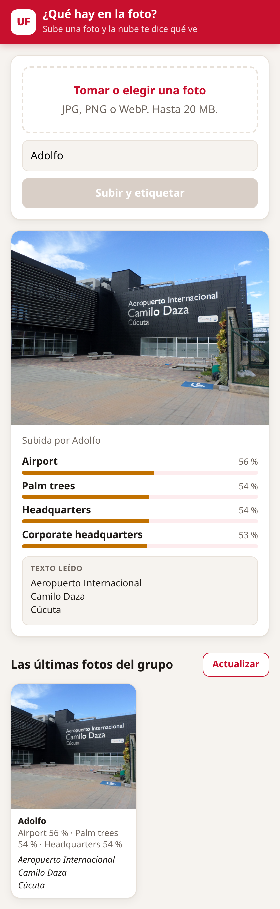

## Preguntas

**¿Por qué la foto de la fase 2 sigue sin etiquetas después de habilitar Vision, y qué tendría que cambiar en el backend para que las tuviera?**
Porque el backend llama a Vision una sola vez, dentro de `POST /fotos`, mientras sube la foto. Cuando subimos la taza en la fase 2, Vision respondió `403 SERVICE_DISABLED`, y el backend guardó la foto igual, con los metadatos `etiquetas = ""` y `vision = "error: 403 ..."`. Después nadie vuelve a preguntar: `GET /fotos` solo lee los metadatos que ya están en el bucket, y habilitar la API no cambia objetos que ya existen. Para que la tuviera, el backend tendría que reintentar el etiquetado de las fotos que quedaron con `vision` en error. La forma más simple es un endpoint, como `POST /fotos/<id>/etiquetar`, o un paso al listar, que vuelva a mandar la miniatura a Vision y reescriba los metadatos (`blob.metadata = ...; blob.patch()`, una operación de clase A más). La forma más sólida es separar el etiquetado de la subida: que el bucket avise con una notificación de Pub/Sub o Eventarc cada vez que se crea una miniatura, y que un servicio aparte la etiquete. Esa entrega se reintenta sola si Vision falla, como la cocina de la práctica 5, y con una suscripción de mensajes muertos para las que nunca lo logren.

**Si le quitan el permiso `storage.objectUser` a la cuenta del backend, ¿qué deja de funcionar, qué ve el usuario y dónde encontrarían el error?**
Deja de funcionar todo lo que toca el bucket, que es todo menos la página misma, cuando el cambio de IAM se propaga, en uno o dos minutos. Subir falla con un `500`. Peor aún: el backend primero hace la miniatura y llama a Vision, gastando sus dos unidades, y después `upload_from_string` recibe un `403` de Cloud Storage que el código no atrapa. La galería no carga, porque el listado de `miniaturas/` da `403` y el backend responde `500`, y las miniaturas que ya estaban en pantalla tampoco se pueden volver a descargar. Lo que el usuario ve en el teléfono es el aviso rojo arriba de la página o el error bajo el formulario, que dice **«El backend respondió 500»**. No ve el motivo: Flask devuelve su página de error y no un JSON con `error`. Las fotos no se pierden, siguen en el bucket. Simplemente el backend ya no puede llegar a ellas. El error se encuentra en los registros del backend en Cloud Logging (servicio `jorge-adolfo-backend`), como un traceback con `403 ... does not have storage.objects.create access` (o `storage.objects.list` al listar), y en su registro de solicitudes (`run.googleapis.com/requests`), con todas las llamadas en `500`. Quién quitó el permiso y cuándo se ve en los registros de auditoría (*Admin Activity*) del bucket, como un `SetIamPolicy`.

**¿Por qué el backend le manda a Vision la miniatura y no el original? Den dos razones distintas.**
(1) **Tamaño y límites de la petición.** La imagen viaja en base64 dentro de la petición a Vision, que admite como máximo unos 10 MB por imagen en línea (y unos 40 MB la petición completa). Nuestro letrero pesa 5,9 MB, que en base64 son casi 8 MB, y una foto de teléfono de 12 a 20 MB no pasaría. La miniatura pesa unos 100 KB: la petición sale y vuelve mucho más rápido, y el usuario espera menos para ver sus etiquetas. (2) **Al modelo no le hace falta más resolución, y el resultado sale más uniforme.** Vision reduce internamente las imágenes grandes antes de analizarlas y recomienda unos 640 × 480 px para etiquetas, así que mandar 12 MP no mejora las etiquetas: solo gasta subida, memoria y tiempo del backend. Además, la miniatura ya viene con la orientación EXIF corregida y convertida a RGB, así que Vision ve la foto derecha y en el mismo formato siempre, sea JPEG, PNG o WebP, y vertical u horizontal. La desventaja aparece en el reto: para leer letras pequeñas, la miniatura de 1024 px tiene menos detalle que el original.

## Créditos de las fotos

Las fotos de prueba se buscaron en la web. Todas, menos el dibujo, son de Wikimedia Commons, con licencia libre:

- **Taza de té:** [Herbal tea in white mug.jpg](https://commons.wikimedia.org/wiki/File:Herbal_tea_in_white_mug.jpg), CC BY-SA 4.0. Las versiones «movidas» las hicimos nosotros a partir de esta.
- **Arepas de huevo:** [Arepa de huevo.jpg](https://commons.wikimedia.org/wiki/File:Arepa_de_huevo.jpg), Jdvillalobos, CC BY 3.0.
- **Letrero:** [Letrero Aeropuerto Camilo Daza de Cúcuta.jpg](https://commons.wikimedia.org/wiki/File:Letrero_Aeropuerto_Camilo_Daza_de_C%C3%BAcuta.jpg), CC BY-SA 4.0.
- **Dibujo n.º 1 de *El principito*,** la boa que digiere un elefante vista por fuera, el «sombrero», de Antoine de Saint-Exupéry. Se tomó de la página de lectura de *The Little Prince* del proyecto C-LARA de la University of South Australia. Se usó solo como foto de prueba, con fines educativos.
